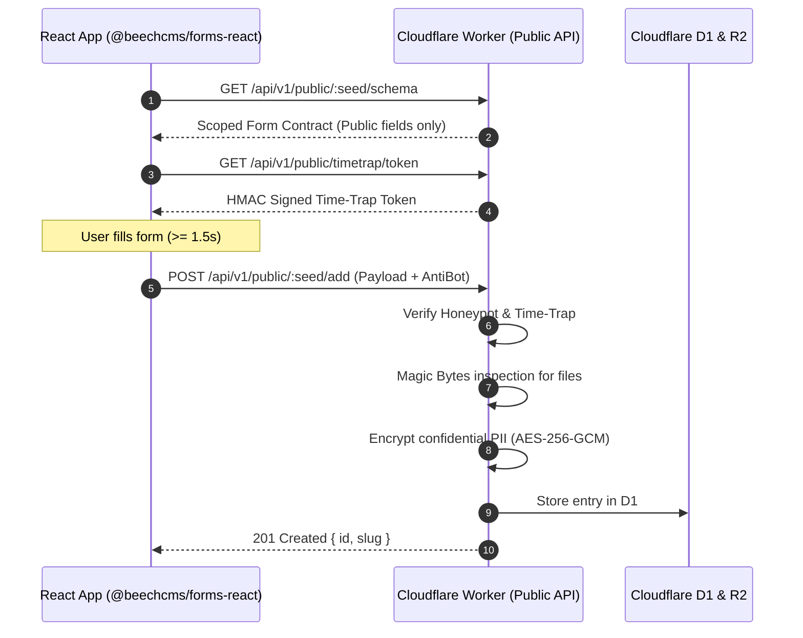

# Forms SDK & Protection

`@beechcms/forms-react` is an edge-native React toolkit for building secure, dynamic forms connected directly to your BeechCMS backend.

---

## Why Use the SDK

Building forms manually requires repetitive boilerplate: state management, validation, anti-spam, draft restoration, and file parsing.

| Challenge | Manual Implementation | With `@beechcms/forms-react` |
| :--- | :--- | :--- |
| **CMS Sync** | Manually update components & schemas on every CMS change | **Zero-Config Sync**: Updates immediately from the CMS |
| **Spam Defense** | Third-party CAPTCHAs that hurt conversion | **Invisible Anti-Bot**: HMAC Time-Trap + Camouflaged Honeypot |
| **Speed & CLS** | Network waterfalls cause layout shifts | **SWR Caching**: Cached in `sessionStorage` for 0ms mount |
| **Data Privacy** | Complex client/server cryptographic pipelines | **Zero-Trust Encryption**: PII encrypted at rest with AES-256-GCM |
| **User Experience** | Accidental refresh loses all typed data | **Draft Auto-Save**: Preserves form values across reloads |

---

## Interactive CLI Generator

Generate a customized form component for **React**, **Vue 3**, **Svelte 5**, or **Vanilla JS / Web Components** in seconds:

```bash
npx @beechcms/cli@latest forms
# or using local beech CLI:
pnpm beech forms
```

The interactive wizard asks which framework you are using and scaffolds the component directly into `src/components/BeechForm.[tsx|vue|svelte|js]` with anti-bot defenses built-in.

---

## Installation (React SDK)

```bash
pnpm add @beechcms/forms-react
# or
npm install @beechcms/forms-react
```

---

## Quick Start

Render a complete, production-ready form in one line with `<BeechForm />`:

```tsx
import React from 'react'
import { BeechForm } from '@beechcms/forms-react'

export function ContactSection() {
  return (
    <div className="max-w-xl mx-auto p-6 bg-white rounded-lg shadow">
      <BeechForm
        seed="clienti"
        baseUrl="https://api.yourdomain.com"
        locale="it"
        onSuccess={({ id }) => alert(`Success! ID: ${id}`)}
      />
    </div>
  )
}
```

> [!NOTE]
> Forms need no key. The schema read and the submission are zero-secret and protected by the Time-Trap token. Do not set `apiKey`: the publishable key is refused on submissions (403 `public-api-secret-key-required`), and the secret key must never reach a browser.

### Under the Hood
1. **Dynamic Schema**: Loads public fields from `GET /api/v1/public/:seed/schema`.
2. **Auto-Rendering**: Generates inputs, dropdowns, textareas, and file uploaders.
3. **Anti-Bot Defense**: Injects invisible honeypot and verifies HMAC time token.
4. **Draft Storage**: Auto-saves typing progress to `localStorage` to prevent data loss. Drafts expire after 24 hours of inactivity and never include fields classified above `public` (see [Draft Storage](#draft-storage)).

---

## Headless Mode (Custom UI)

For complete control over markup and styling (e.g. Tailwind CSS, Shadcn UI), use `useBeechForm`:

```tsx
import React from 'react'
import { useBeechForm, Honeypot } from '@beechcms/forms-react'

export function CustomContactForm() {
  const form = useBeechForm({
    seed: 'clienti',
    baseUrl: 'https://api.yourdomain.com',
    onSuccess: (res) => alert(`Saved! ID: ${res.id}`),
  })

  if (form.isSuccess) {
    return <div className="p-4 bg-green-50 text-green-700 rounded">Thank you! Message sent.</div>
  }

  return (
    <form onSubmit={form.handleSubmit} className="space-y-4 max-w-lg mx-auto" noValidate>
      {/* 🛡️ 1-line invisible anti-bot protection */}
      <Honeypot form={form} />

      <div>
        <label className="block text-sm font-medium">Name *</label>
        <input {...form.register('name')} className="input-field" placeholder="Jane Doe" />
        {form.errors.name && <p className="text-red-500 text-xs">{form.errors.name}</p>}
      </div>

      <div>
        <label className="block text-sm font-medium">Email *</label>
        <input {...form.register('email')} type="email" className="input-field" placeholder="jane@company.com" />
        {form.errors.email && <p className="text-red-500 text-xs">{form.errors.email}</p>}
      </div>

      {form.serverError && <p className="text-red-600 text-sm">{form.serverError}</p>}

      <button type="submit" disabled={form.isSubmitting} className="btn-primary">
        {form.isSubmitting ? 'Sending...' : 'Send Message'}
      </button>
    </form>
  )
}
```

When the API rejects a submission with per-field errors (`400` with an `errors[]` array, e.g. a `min`/`max` or tag-vocabulary rule the browser cannot check), each message lands in `form.errors[field]` and the field is marked touched. `form.serverError` then holds only the messages for fields the form does not render, or the problem `detail` when the response has no `errors[]`.

---

## Customization

### Field Filtering
Filter which fields to render without changing CMS definitions:

```tsx
<BeechForm
  seed="clienti"
  baseUrl="https://api.yourdomain.com"
  includeFields={['name', 'email', 'message']}
  excludeFields={['internal_notes']}
/>
```

### Draft Storage
While a visitor types, the form writes its values in plain text to `localStorage` (`beech_form_draft_<seed>`) and restores them on the next visit. Anything typed stays readable on that browser until the draft expires or the form is submitted, so treat it as a privacy decision:

- Fields whose branch `policies.classification` is `internal`, `restricted` or `confidential` are never stored.
- `excludeFromDraft` keeps further fields out, e.g. a phone number or a free-text message.
- `draftTtlMs` sets how long an untouched draft survives (default 24 hours). Expired drafts, and drafts written before expiry existed, are deleted the next time any form from the same origin mounts.
- `disableDraft` turns the feature off entirely.

```tsx
<BeechForm
  seed="clienti"
  baseUrl="https://api.yourdomain.com"
  excludeFromDraft={['phone', 'message']}
  draftTtlMs={60 * 60 * 1000}
/>
```

> [!NOTE]
> Branches without an explicit classification count as `public` and are stored. On forms that collect personal data, classify the sensitive branches, list them in `excludeFromDraft`, or set `disableDraft`.

### Localization
Switch languages (`it` | `en`) or pass custom dictionaries:

```tsx
<BeechForm
  seed="clienti"
  baseUrl="https://api.yourdomain.com"
  locale="it"
  translations={{
    submitButton: "Invia Richiesta",
    successTitle: "Ricevuto!",
  }}
/>
```

### File Uploads
Files are checked against Magic Bytes signatures and encoded automatically:

```tsx
<input
  type="file"
  accept=".pdf,.png,.jpg"
  onChange={(e) => form.handleFileChange('cv_attachment', e.target.files?.[0] ?? null)}
/>
```

### Anti-Bot Options
Customize honeypot decoy names or disable in test environments:

```tsx
<BeechForm
  seed="clienti"
  baseUrl="https://api.yourdomain.com"
  honeypotField="fax_number"
  disableAntiBot={process.env.NODE_ENV === 'test'}
/>
```

---

## Security Architecture



The time-trap token is single use and valid from 1.5 seconds to 1 hour after it is issued. `useBeechForm` fetches one on mount and a new one after every submit the server answers (success or failure), so a second submission after `reset()` and a retry after an error both work in the same page. A token close to the end of its hour is replaced at submit time; because the new token is younger than 1.5 seconds, that submit shows the `timeTrapWarning` message and the next click goes through. Tests can pass a `clock` (`{ now(): number }`) instead of faking timers.

---

## Related Guides

- [Client SDK](/reference/client-sdk) — Official TypeScript client for data fetching.
- [Public API Reference](/reference/public-api) — Complete technical specification and endpoints.
- [Automations](/features/automations) — Triggering automatic emails on submission.
- [First Project](/start/first-project) — Step-by-step tutorial.
